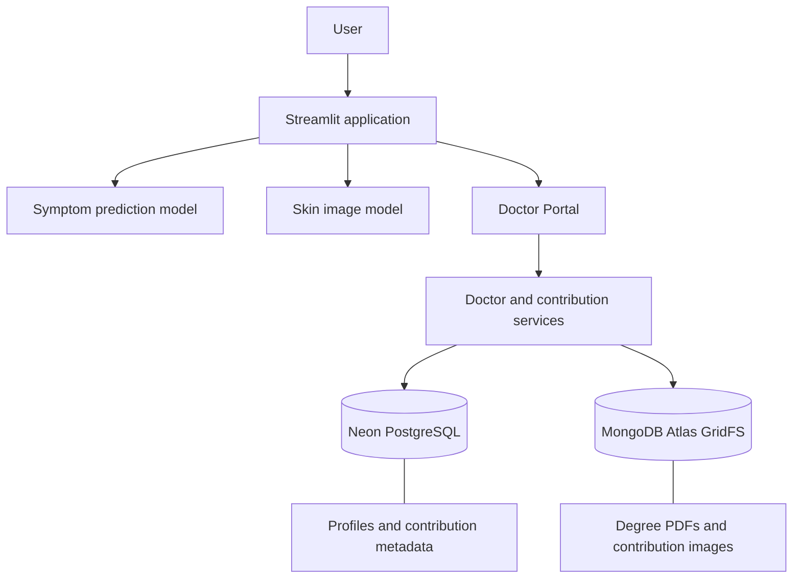

# Disease Akinator

**Production demo:** https://disease-akinator-we7wpcyvg2tc4niefueebu.streamlit.app/

A multimodal, Streamlit-based **educational disease-prediction prototype** with two prediction paths—symptom-based prediction and skin-image classification—and a Doctor Portal for storing structured contributions.

> **Medical disclaimer:** Disease Akinator is an academic project, not a medical device. Its outputs are experimental predictions, not diagnoses or treatment advice. Do not use them to make healthcare decisions or delay professional medical care.

## Features

### 1. Symptom-based prediction
- Interactively asks up to 25 symptom questions.
- Accepts four response levels: Yes, Probably, Probably Not, and No.
- Uses the saved scikit-learn probability model and symptom feature list.
- Displays prediction results from the model's class probabilities.

### 2. Skin-image classification
- Accepts JPEG and PNG images.
- Loads the saved TensorFlow/Keras skin-classification model.
- Resizes and prepares images for the model's 160 × 160 RGB input.
- Displays the top five predicted classes and their confidence scores.

### 3. Doctor Portal
- Doctor registration with profile details, email, password, and a degree-document PDF.
- Email/password login; passwords are hashed with Argon2id.
- Symptom contributions are stored as structured PostgreSQL records.
- Image contributions are stored as files in MongoDB GridFS, with metadata in PostgreSQL.
- Dashboard statistics are read from PostgreSQL.

**Important current limitations**
- Registration collects doctor-entered details and a PDF; the application does not independently verify the qualification or approve the account. Do not describe an account as a verified doctor.
- Contributions are stored for future review/research. They do **not** automatically retrain or update the deployed prediction models.
- An administrator review/approval workflow, email verification, and password-reset workflow are not implemented yet.

## Architecture



### Data storage

**Neon PostgreSQL** stores structured records in these tables:
- `doctors`
- `symptom_contributions`
- `symptom_contribution_items`
- `image_contributions`

**MongoDB Atlas GridFS** stores binary files in two buckets:
- `doctor_degrees`
- `contribution_images`

The PostgreSQL records retain the GridFS file IDs and relevant file metadata. The application reads credentials from environment variables or Streamlit secrets; credentials must never be committed to Git.

### Model artifacts

The five model artifacts are tracked with Git LFS:
- `final_ensemble.pkl`
- `feature_names.pkl`
- `imputer.pkl`
- `skin_model.h5`
- `class_names.pkl`

The symptom and image model files are pre-trained artifacts. The application does not train models at startup.

## Dataset provenance and model-development lifecycle

The production repository includes the deployed model artifacts and runtime inference pipelines. It does **not** currently include the original raw datasets, complete dataset audit reports, training notebooks/scripts, split manifests, or held-out evaluation reports. The image page identifies its classifier as **ResNet50 (DermNet NZ)**; the exact dataset release/licence and original training record are not independently established by the files in this repository. The symptom dataset source/version is likewise not recorded here.

For the exact verified inference preprocessing, artifact roles, known dataset-provenance gaps, training reproducibility requirements, database lifecycle, and production deployment sequence, see **[Dataset, Model, and Production Lifecycle](docs/PROJECT_LIFECYCLE.md)**.

For the model-development record specifically—including the dataset descriptions, available preprocessing, symptom train/test split, model candidates/ensemble evidence, exported formats, and the reported ~91% / ~82% accuracy figures—see **[Model Development: Datasets, Training, and Exports](docs/MODEL_DEVELOPMENT.md)**. That page distinguishes the available Colab training-code snapshot from older project-summary descriptions where they do not match.

The README's approximate 91% symptom and 82% image accuracy figures are historical project-reported results; the corresponding evaluation reports and test protocol are not present in this repository. They are not clinical-performance claims.

## Technology stack

| Layer | Technology |
|---|---|
| UI and application | Python, Streamlit |
| Symptom prediction | scikit-learn, joblib, NumPy |
| Skin-image prediction | TensorFlow/Keras, Pillow |
| Structured database | Neon PostgreSQL, Psycopg 3 |
| Binary file storage | MongoDB Atlas, PyMongo GridFS |
| Password hashing | Argon2id via argon2-cffi |
| Large model files | Git LFS |
| Tests | pytest, unit and database integration tests |

## Repository layout

```text
Disease-Akinator/
├── app.py
├── database/
│   ├── __init__.py
│   ├── postgres.py
│   ├── mongodb.py
│   └── schema.sql
├── services/
│   ├── __init__.py
│   ├── auth_service.py
│   ├── doctor_service.py
│   └── contribution_service.py
├── tests/
│   ├── test_auth_service.py
│   ├── test_auth_integration.py
│   ├── test_doctor_service.py
│   ├── test_doctor_registration_integration.py
│   ├── test_contribution_service.py
│   ├── test_contribution_integration.py
│   ├── test_postgres_integration.py
│   └── test_mongodb_integration.py
├── assets/
├── verify_environment.py
├── verify_model_assets.py
├── requirements.txt
└── README.md
```

## Run locally

### Prerequisites
- Windows, macOS, or Linux.
- Python **3.13.x** for the dependency set currently tested by this project.
- Git and Git LFS.
- Access to a Neon PostgreSQL database and MongoDB Atlas cluster to use the Doctor Portal.

### 1. Clone and download the model files

```bash
git lfs install
git clone https://github.com/atharva315/Disease-Akinator.git
cd Disease-Akinator
git lfs pull
```

### 2. Create the Python environment

**Windows Command Prompt**
```cmd
py -3.13 -m venv .venv
.venv\Scripts\activate
python -m pip install --upgrade pip
python -m pip install -r requirements.txt
```

**macOS / Linux**
```bash
python3.13 -m venv .venv
source .venv/bin/activate
python -m pip install --upgrade pip
python -m pip install -r requirements.txt
```

### 3. Configure database credentials

Create `.streamlit/secrets.toml` locally (this file is ignored by Git) with your own connection strings:

```toml
[postgres]
url = "postgresql://<user>:<password>@<host>/<database>?sslmode=require"

[mongodb]
uri = "mongodb+srv://<user>:<password>@<cluster-host>/?retryWrites=true&w=majority"
```

Replace every placeholder with credentials from your own services. Do not paste real credentials into source files, commits, issues, screenshots, or chat messages.

The application also supports these environment variables:
- `DISEASE_AKINATOR_POSTGRES_URL`
- `DISEASE_AKINATOR_MONGODB_URI`

### 4. Prepare the databases

1. Create a PostgreSQL database and a restricted application role.
2. Apply `database/schema.sql` using the database owner/admin role after creating the application role referenced by the script.
3. Create a MongoDB Atlas database/cluster and an application database user with access to the `disease_akinator` database.
4. Configure network access for the environment where the app will run. Avoid broad public access where your hosting/network setup allows restricted IP access.

The application expects the PostgreSQL database name `disease_akinator`, and creates/uses the GridFS buckets `doctor_degrees` and `contribution_images`.

### 5. Run the preflight checks and app

```bash
python verify_environment.py
python verify_model_assets.py
python -m pip install pytest
python -m pytest -q
python -m streamlit run app.py
```

Open the local URL printed by Streamlit. Symptom and image prediction do not require database credentials; Doctor Portal registration, login, contributions, and dashboard statistics require working PostgreSQL and MongoDB configuration.

## File upload limits

| Upload | Accepted format | Maximum size |
|---|---|---:|
| Doctor degree document | PDF | 10 MB |
| Contribution image | JPEG or PNG | 5 MB |

The backend checks file extensions, signatures, and size limits before storing uploads.

## Tests and verification

The repository includes unit tests and integration tests for authentication, doctor registration, PostgreSQL operations, MongoDB/GridFS operations, and contribution workflows.

In the development environment used for this migration, the reported local test run completed with **31 tests passed**. Database integration tests require test database credentials and should be run only against a dedicated test environment—not a production database.

## Deployment notes

The application is designed for Streamlit hosting. For a staging or production deployment:

1. Deploy the intended Git branch with `app.py` as the entry point.
2. Add the `postgres` and `mongodb` sections to the hosting provider's secrets configuration.
3. Ensure the host can access the Neon and MongoDB Atlas services.
4. Confirm Git LFS model artifacts are available to the build/runtime.
5. Run the diagnosis and Doctor Portal smoke tests after deployment.

Do not reuse production database credentials in staging. Use separate staging database resources or isolated staging data.

## Evaluation results

The project evaluation previously reported approximately:
- **91%** symptom-prediction accuracy.
- **82%** skin-image classification accuracy.

These are project-reported model evaluation figures, not independent clinical validation or a guarantee of accuracy on new users or images.

## Responsible use

- Outputs are experimental and may be incorrect.
- Confidence scores are model probabilities, not calibrated clinical certainty.
- Uploaded health-related material should be synthetic or shared only with appropriate permission and safeguards.
- Do not upload identifiable patient information.
- Doctor registration and document upload do not constitute professional credential verification.

## License

No license is currently specified. Unless a license is added, the repository should be treated as source-available for viewing, not as granting permission to reuse, modify, or redistribute the code.
